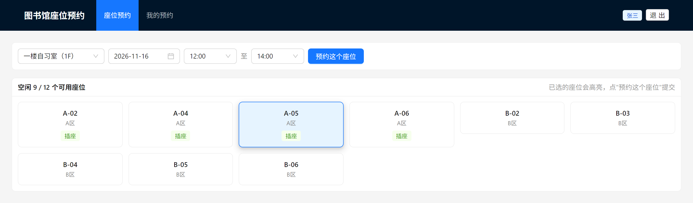
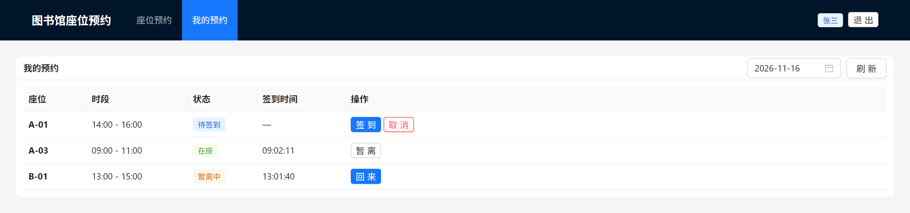
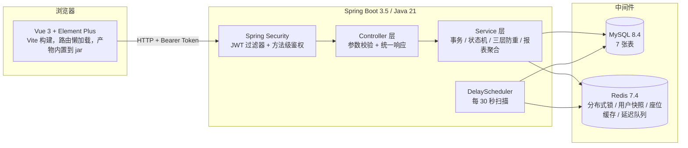
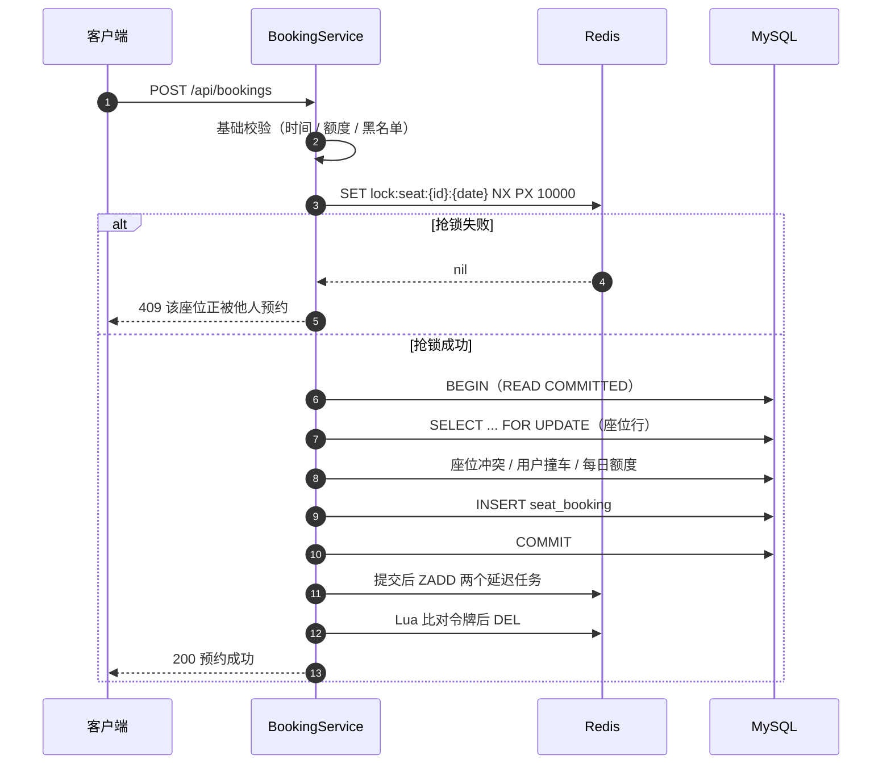
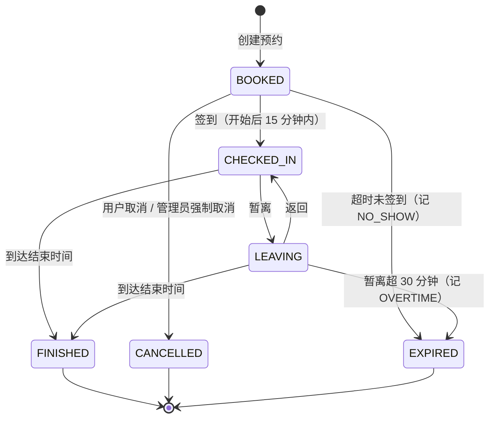

# 研习空间预约与履约平台 · seat-reserve


面向高校自习场景的**预约—履约闭环系统**：选座、签到、暂离、到期完成、超时违约、信用拉黑全流程，用户侧 + 管理员侧双角色。
后端 Spring Boot 3 + MyBatis + MySQL + Redis，前端 Vue 3 + Element Plus + Pinia，前后端一起打成**单个可执行 jar** 运行。

项目重心不在 CRUD，而在三件容易被忽略的事：

- **并发下不会重复预约**——三层防重：Redis 分布式锁挡流量 → 数据库行锁保互斥 → 时间区间判据定语义。
- **预约状态全自动流转**——Redis ZSet 延迟队列驱动，不用引入 MQ 也能做超时失效、到期完成、暂离超时。
- **从工具到平台**——运营看板（履约率 / 使用率 / 违约排行）+ 管理后台（座位上下架、预约强制取消、违约拉黑），形成完整业务闭环。

---

## 目录

- [项目简介](#项目简介)
- [功能特性](#功能特性)
- [界面预览](#界面预览)
- [技术栈](#技术栈)
- [系统架构](#系统架构)
- [核心设计](#核心设计)
- [快速开始](#快速开始)
- [接口一览](#接口一览)
- [项目结构](#项目结构)
- [数据库设计](#数据库设计)
- [测试](#测试)
- [已知边界与取舍](#已知边界与取舍)
- [相关文档](#相关文档)
- [许可证](#许可证)

---

## 项目简介

高校自习座位「先到先得」的痛点不是没有系统，而是抢座瞬间的并发写和后续的状态无人维护：
两个人同时点「预约」，都能查到空位；预约到点没人来，座位空占一整天；临时离开的人不回来，系统却仍显示「使用中」。

本系统用一个完整的状态机把座位从「被预约」到「被释放」的每一步都管起来：

```
创建预约 → 签到 → 暂离 ⇄ 返回 → 结束
             │
             ├─ 超时未签到 → 失效 + NO_SHOW 违约 ─┐
             └─ 暂离超时   → 失效 + OVERTIME 违约 ─┴→ 累计 3 次 → 拉黑 7 天
```

并发写入用三层机制兜住，状态推进交给延迟队列自动完成，用户只需要做「签到 / 暂离 / 返回 / 取消」四个动作。管理员侧另有运营看板与后台管理入口。

## 功能特性

### 用户侧

| 模块 | 能力 |
| --- | --- |
| 认证 | 账号密码登录，签发 JWT；黑名单状态实时生效，拉黑后旧 token 立刻失效 |
| 座位浏览 | 按阅览室查看座位，展示分区、是否有插座、维修中置灰 |
| 空闲查询 | 按「日期 + 时段」一次查出整间阅览室的空闲座位，`NOT EXISTS` 子查询避免 N+1 |
| 创建预约 | 30 分钟粒度、单次最长 4 小时、每日最多 3 单、必须在阅览室开放时间内 |
| 冲突校验 | 同座位时段重叠、同用户时段撞车、每日额度（锁外预判 + 锁内权威判定） |
| 签到 | 开始后 15 分钟内可签到，超时自动失效并记 `NO_SHOW` 违约 |
| 暂离 / 返回 | 暂离 30 分钟内可返回，超时自动失效并记 `OVERTIME` 违约 |
| 取消 | 仅「待使用」状态可取消，本人或管理员操作，同时摘掉延迟任务 |
| 到期完成 | 到达预约结束时间自动置为 `FINISHED`，无需用户操作 |
| 违约管理 | 累计 3 次违约自动拉黑 7 天，期间禁止预约 |
| 审计 | 每次状态流转写入 `booking_log`（含系统自动流转），可追溯 |

### 管理员侧

| 模块 | 能力 |
| --- | --- |
| 运营看板 | 预约总量、履约完成、违约作废、**履约率**（分母排除用户主动取消）、累计预约小时数 |
| 排行统计 | 座位使用排行、违约用户排行、时段热力；按日期区间筛选，服务层限制单次最多 92 天 |
| 座位管理 | 座位增删改 / 置维修；写操作后主动失效 Redis 座位缓存，避免用户看到已下架座位 |
| 预约管理 | 按日期 / 状态查全部预约（JOIN 出预约人、座位号、阅览室），强制取消复用用户取消的同一套逻辑 |
| 一致性校验 | 有进行中预约的座位不允许置维修；有历史预约的座位不允许物理删除 |

> 管理端接口统一用 `@PreAuthorize("hasRole('ADMIN')")` 做方法级鉴权，前端隐藏菜单只是体验，权限边界在后端。

## 界面预览

> 以下截图来自项目早期版本，界面为演示数据（一楼自习室 12 个座位）。当前前端已迁移至 Vue 3 + Element Plus，交互与布局一致但视觉有更新。

**座位预约**：选阅览室 → 选日期 → 选时段，空闲座位一次列全；点座位高亮，提交后直接跳到「我的预约」。



**我的预约**：按日期查，状态不同给出的操作也不同——待签到可以签到/取消，在座可以暂离，暂离中可以回来。



**登录**：账号密码换 JWT，token 存 localStorage，刷新页面不会掉登录态。


## 技术栈

### 后端

| 技术 | 版本 | 用途 |
| --- | --- | --- |
| Java | 21 | 语言运行时 |
| Spring Boot | 3.5.4 | 应用框架 |
| Spring Security | 6.x | 认证过滤链、方法级鉴权（`@PreAuthorize`） |
| MyBatis | 3.0.4（starter） | 持久层，手写 SQL 与 XML 映射 |
| MySQL | 8.4 | 业务数据存储，InnoDB |
| Redis | 7.4 | 分布式锁、用户快照缓存、座位缓存、延迟队列 |
| Flyway | 随 Boot 版本 | 建表与种子数据版本化 |
| JJWT | 0.12.6 | JWT 签发与校验（HS256） |
| Lombok | 随 Boot 版本 | 日志与样板代码 |

> 刻意没有引入 MyBatis-Plus、Redisson、消息队列：行锁、区间判据、延迟队列都手写，是为了把并发控制的每一步落在可控的代码里。

### 前端

| 技术 | 版本 | 用途 |
| --- | --- | --- |
| Vue | 3.5 | UI 框架（Composition API + `<script setup>`） |
| Vite | 8 | 开发服务器与构建 |
| Element Plus | 2.11 | 组件库（表格、表单、日期选择、消息提示） |
| Pinia | 3 | 登录态存储（token / user 持久化） |
| Vue Router | 4 | 路由、登录守卫与管理员角色守卫，路由懒加载 |
| Axios | 1.x | 请求封装、统一错误提示、401 拦截 |
| dayjs | 1.11 | 时间格式化与时段计算 |

## 系统架构



前后端分离开发、合并部署：开发时 Vite 把 `/api` 代理到 8080；构建时 `outDir` 直接指向 `src/main/resources/static`，`SpaForwardController` 负责把前端路由 forward 回 `index.html`，刷新 `/admin/seats` 等深层路由不会 404。

## 核心设计

### 1. 三层防重：每一层解决的不是同一个问题

预约的本质是 check-then-act：**「查有没有冲突」和「插入记录」之间存在时间差**，并发请求会同时查到「没有冲突」。
`version` 乐观锁在这里无效——它防的是更新同一行，而冲突发生在插入新行，没有行可以携带版本号。

| 层 | 手段 | 解决的问题 | 失效后果 |
| --- | --- | --- | --- |
| L1 | Redis `SET key token NX PX 10000`，Lua 比对令牌后删除 | 把并发挡在数据库外，避免大量请求堆在行锁上打穿连接池 | 只是变慢，正确性不受影响 |
| L2 | 事务内 `SELECT id FROM lib_seat WHERE id = ? FOR UPDATE` | 同一座位的写入串行化，锁与事务同生共死 | 高并发下可能超卖 |
| L3 | 左闭右开区间判据 `start < :end AND end > :start` | 定义「什么算冲突」：18:00 结束与 18:00 开始不算冲突 | 串行地插入两条重叠记录 |

几个关键取舍：

- **锁父行而不是锁预约表**：要插入的那一行还不存在，没有索引条目可锁，所以拿「必然存在的座位行」当锚点，把「子记录的插入」串行化。
- **隔离级别显式设为 `READ_COMMITTED`**：RR 下事务第一条 SELECT 就固定了快照，后到的请求看不见前一个请求刚提交的预约，冲突检测会失效；RC 每条语句重新取快照，才看得见。
- **Redis 锁 TTL 只有 10 秒且不做续期**：敢设这么短，是因为正确性由 L2 兜底，L1 只负责削峰。



### 2. 状态机：所有流转都是 CAS



每条 UPDATE 都把「期望的旧状态」写进 `WHERE`，用受影响行数判断是否抢到这次流转：

```sql
UPDATE seat_booking SET status = 'CHECKED_IN', checkin_at = NOW(), version = version + 1
WHERE id = ? AND status = 'BOOKED';
```

这样用户点「签到」和延迟队列判「超时」同时到达时，只有一方能成功，另一方拿到 0 行后放弃——不需要额外的锁，也不会出现 `EXPIRED` 又被改回 `CHECKED_IN`。

管理员强制取消复用同一个 `BookingService.cancel`：CAS 语义、写入 `booking_log`（`operator_id` 记录管理员）、事务提交后摘延迟任务，与用户自助取消完全一致。

### 3. 延迟队列：不引入 MQ 也能做定时流转

三个 Redis ZSet，`score` 是到期时间戳，`member` 是预约 id：

| 队列 | 到期时刻 | 到期的处理 |
| --- | --- | --- |
| `delay:checkin` | 开始时间 + 15 分钟 | 未签到 → `EXPIRED` + 违约 |
| `delay:leave` | 暂离时间 + 30 分钟 | 未返回 → `EXPIRED` + 违约 |
| `delay:finish` | 预约结束时间 | `FINISHED` |

`DelayScheduler` 每 30 秒扫一轮，每轮最多取 200 条，三个队列各用一把 Redis 锁互斥，多实例部署时同一轮只有一个实例在跑。

两个容易踩的点已经在代码里处理：

- **入队 / 出队必须等事务提交**（`AfterCommit`）：事务回滚时 Redis 不在同一个事务里，提前入队会留下指向不存在预约的幽灵任务。
- **超时处理不能整批套一个事务**：循环里单条失败会把外层事务标记为 rollback-only，一条异常带着整批回滚。这里用 `TransactionTemplate` 按条提交，`markExpired` 与 `violation.record` 要么一起成功，要么一起回滚。

### 4. 违约与拉黑

- 未签到记为 `NO_SHOW`，暂离超时记为 `OVERTIME`。
- 累计 3 次自动拉黑 7 天，拉黑时把计数清零，避免第 4 次违约重复刷新解禁时间。
- 拉黑后清除 Redis 里的用户快照，手上的旧 token 下一次请求直接 401，重新登录才能拿到新状态。

### 5. 鉴权：无状态 token + 有状态快照

JWT 只携带用户 id，角色、黑名单等易变信息放在 Redis 快照里（`UserSnapshotStore`）。
纯 JWT 无法即时吊销，纯 Session 又要引入共享存储；这里用「token 无状态 + 快照可清除」拿到两者的折中：校验仍然是无状态的一次查询，权限变更却能立刻生效。

管理端接口在类上加 `@PreAuthorize("hasRole('ADMIN')")`：因为过滤器把 authority 拼成 `ROLE_` + roleCode，所以用 `hasRole` 而非 `hasAuthority`（后者不会补前缀）。

### 6. 报表与管理后台

- **报表不新建事实表**：直接聚合 `seat_booking` / `booking_log` / `violation`，复用 V3 加的 `(book_date, status)` 索引支撑按日期区间的筛选。
- **履约率口径**：`FINISHED / (FINISHED + EXPIRED)`，分母刻意排除 `CANCELLED`——用户主动取消不代表平台失约。
- **缓存一致性**：座位是缓存读（`cache:seat:room:{roomId}`，10 分钟），管理端任何写操作后主动 `evictRoomCache`，避免用户看到已下架的座位。
- **引用完整性**：有进行中预约的座位不允许置维修；有历史预约的座位不允许物理删除，只能停用。

## 快速开始

### 环境要求

| 依赖 | 版本 | 说明 |
| --- | --- | --- |
| JDK | 21 | 必须，`pom.xml` 中 `java.version=21` |
| Docker | 24+ | 用来起 MySQL 与 Redis，也可用本机安装的实例 |
| Node.js | 22+ | 仅前端开发 / 重新构建时需要 |

### 1. 启动 MySQL 与 Redis

```bash
cp .env.example .env      # 填入 MYSQL_ROOT_PASSWORD
docker compose up -d
```

MySQL 会以 `seat_reserve` 作为库名启动（`MYSQL_DATABASE`），表结构与种子数据由 Flyway 在应用启动时自动执行。

### 2. 配置密钥

数据库密码和 JWT 密钥都通过占位符注入，仓库里没有任何明文：

```bash
cp secrets.local.yaml.example secrets.local.yaml
```

```yaml
# secrets.local.yaml（已被 .gitignore 忽略，不会提交、不会打进 jar）
DB_PASSWORD: 与 .env 里的 MYSQL_ROOT_PASSWORD 保持一致
JWT_SECRET: 用 openssl rand -hex 32 生成的 64 位十六进制串
```

也可以不用文件，直接设同名环境变量（部署 / CI 走这条）：`DB_PASSWORD`、`JWT_SECRET`。
占位符没有默认值，缺配置时应用会以 `Could not resolve placeholder` 明确终止启动，而不是带着弱密钥跑起来。

### 3. 启动应用

```bash
./mvnw spring-boot:run
```

打开 <http://localhost:8080> 即可。首次启动 Flyway 会建表并写入种子数据。

### 4. 前端开发（可选）

仓库里的 `src/main/resources/static` 已经是构建好的产物，只改后端时不需要 Node。
需要改前端时：

```bash
cd web
npm install
npm run dev      # http://localhost:5173，/api 自动代理到 8080
npm run lint     # eslint 校验（vue 插件）
npm run build    # 产物直接写入 src/main/resources/static，随后 jar 即可直接提供页面
```

> 注意：改了 `web/` 下的源码必须重新 `npm run build` 才会生效——前端是构建进静态资源随 jar 发布的，运行中的实例读的是构建时的版本。

### 演示账号

| 账号 | 密码 | 角色 |
| --- | --- | --- |
| `admin` | `123456` | ADMIN（可看运营看板与后台管理） |
| `zhangsan` | `123456` | USER |

> 种子数据里的密码是 `{noop}` 明文编码，**只为演示方便**。生产环境应改为 `{bcrypt}` 并移除种子账号。

### 打包

```bash
./mvnw clean package
java -jar target/seat-reserve-0.0.1-SNAPSHOT.jar
```

单 jar 内含前端静态资源，只需外部的 MySQL 与 Redis。

## 接口一览

统一响应体 `{ "code": 0, "msg": "ok", "data": ... }`；除登录与健康检查外都需要 `Authorization: Bearer <token>`。管理端接口还需要 ADMIN 角色。

### 用户接口

| 方法 | 路径 | 说明 |
| --- | --- | --- |
| `POST` | `/api/auth/login` | 登录，返回 token 与用户信息 |
| `GET` | `/api/auth/me` | 当前用户（含角色、违约次数、拉黑状态） |
| `GET` | `/api/rooms` | 阅览室列表 |
| `GET` | `/api/rooms/{roomId}/seats` | 某阅览室全部座位（含维修中） |
| `GET` | `/api/rooms/{roomId}/seats/free` | 按时段查空闲座位，`?date=&start=&end=` |
| `GET` | `/api/seats/{seatId}/check` | 单座位在某时段是否可用 |
| `POST` | `/api/bookings` | 创建预约 |
| `GET` | `/api/bookings/my` | 我的预约，`?date=yyyy-MM-dd` 必填 |
| `DELETE` | `/api/bookings/{id}` | 取消预约 |
| `POST` | `/api/bookings/{id}/checkin` | 签到 |
| `POST` | `/api/bookings/{id}/leave` | 暂离 |
| `POST` | `/api/bookings/{id}/back` | 返回座位 |
| `GET` | `/api/ping` | 健康检查（座位总数 + 数据库连通性） |

### 管理端接口（需 ADMIN）

| 方法 | 路径 | 说明 |
| --- | --- | --- |
| `GET` | `/api/admin/overview` | 核心指标，`?from=&to=` |
| `GET` | `/api/admin/seats/rank` | 座位使用排行 |
| `GET` | `/api/admin/violations/rank` | 违约排行 |
| `GET` | `/api/admin/heat` | 时段热力 |
| `GET` | `/api/admin/seats` | 某阅览室全部座位，`?roomId=` |
| `POST` | `/api/admin/seats` | 新增座位 |
| `PUT` | `/api/admin/seats/{id}` | 修改座位（含置维修 / 恢复） |
| `DELETE` | `/api/admin/seats/{id}` | 删除座位（仅允许无预约记录） |
| `GET` | `/api/admin/bookings` | 全部预约，`?date=&status=`（status 可选） |
| `DELETE` | `/api/admin/bookings/{id}` | 强制取消预约（复用用户取消逻辑） |

状态码约定：`400` 参数或规则不满足、`401` 未认证 / token 失效、`403` 越权或被拉黑、`404` 资源不存在、`409` 冲突（抢锁失败、时段已占、状态不可流转）。

## 项目结构

```
library
├── src/main/java/com/seat/reserve
│   ├── common/          R / BizException / 全局异常处理 / RedisLock / AfterCommit
│   ├── config/          Spring Security 过滤链与白名单
│   ├── domain/          实体与状态常量
│   ├── mapper/          MyBatis 接口（含报表与座位管理）
│   ├── security/        JWT 签发、认证过滤器、用户快照缓存
│   ├── service/         预约、状态机、时间校验、延迟队列、违约、报表、座位管理
│   └── web/             Controller 与 DTO，SPA 路由转发
├── src/main/resources
│   ├── db/migration/    V1 建表 / V2 种子数据 / V3 报表索引与发件箱（Flyway）
│   ├── mapper/          MyBatis XML
│   ├── static/          前端构建产物（内置进 jar）
│   └── application.yaml
├── src/test/java        预约规则单元测试
├── web/                 Vue 3 前端源码（Vite + Element Plus + Pinia）
│   ├── src/views/       6 个页面组件（登录 / 选座 / 我的预约 / 看板 / 座位管理 / 预约管理）
│   ├── src/router/      路由与守卫
│   └── src/stores/      Pinia 登录态
├── docs/                设计笔记、改造清单与界面截图
├── docker-compose.yml   MySQL + Redis
└── pom.xml
```

## 数据库设计

7 张表（6 张业务表 + 1 张通知发件箱预留），全部 InnoDB / utf8mb4，由 Flyway 版本化管理：

| 表 | 用途 | 关键点 |
| --- | --- | --- |
| `sys_user` | 用户 | `violation_count`、`blacklist_until` 支撑违约拉黑；V3 补 `email` 列 |
| `lib_room` | 阅览室 | 每间有自己的 `open_time` / `close_time` |
| `lib_seat` | 座位 | `status=0` 表示维修，`uk_room_seat` 保证房间内座位号唯一 |
| `seat_booking` | 预约主表 | `idx_seat_date (seat_id, book_date, status, start_time)` 支撑冲突检测；V3 补 `idx_date_status` 支撑报表 |
| `booking_log` | 状态流转日志 | `operator_id=0` 表示系统自动流转，否则为操作人（含管理员） |
| `violation` | 违约记录 | `NO_SHOW` / `OVERTIME` |
| `notification_task` | 通知发件箱 | V3 预留，**当前未启用通知功能**，表为空 |

索引设计遵循「等值列在前、范围列在后」：冲突查询用得上 `seat_id`、`book_date`、`status`，`start_time` 用作范围条件，`end_time` 回表过滤。报表按 `(book_date, status)` 聚合，正好复用 V3 的索引最左列。

## 测试

```bash
./mvnw test
```

- `BookingValidatorTest`：覆盖时间规则的边界——过去日期、起止倒置、非 30 分钟对齐、超过 4 小时、超出开放时间、当天已结束时段、**当天已开始超过签到宽限**（曾可创建出必然失效的预约）。时间依赖通过 `Clock` 注入固定值，测试不依赖机器当前时间。
- `SeatReserveApplicationTests`：`contextLoads` 需要真实 MySQL + Redis，默认 `@Disabled`，本地把依赖起好后可手动开启。

前端：

```bash
cd web && npm run lint && npm run build
```

CI（`.github/workflows/build.yml`）在每次 push / PR 时执行同样两步：后端 `mvn test` + 前端 `npm ci && npm run lint && npm run build`，全程不需要 MySQL 与 Redis。

## 已知边界与取舍

这些是实现时明确选择的边界，不是待修的 bug：

1. **同用户跨座位并发**：同一用户的两个请求分别预约不同座位时，锁粒度（座位 + 日期）、行锁、座位冲突检测都不相交，理论上可同时通过。修法是加一把 `lock:user:{userId}:{date}`，单用户并发极低，成本几乎为零。
2. **不支持跨天预约**：`book_date + start_time + end_time` 隐含同天假设，跨天需要把时间列改成 `DATETIME`。
3. **时间不带时区**：`LocalTime` 无时区信息，只适用于单机房部署。
4. **没有唯一索引兜底**：时间区间重叠无法用唯一索引表达，除非拆成 30 分钟 slot 子表；所以正确性完全依赖行锁 + 区间判据，这也是三层设计必须讲清楚的原因。
5. **数据库用 root 连接**：本地演示配置，生产应建独立账号并只授予必要权限。
6. **Redis 不可用时认证直接失败**：用户快照存在 Redis，Redis 挂掉会让已登录请求一并失败，属于可用性取舍（换来的是权限变更即时生效）。
7. **管理端不支持强制结束在座预约**：强制取消只作用于 `BOOKED`；结束在座预约涉及记违约与状态机语义，与取消是两回事，刻意不做。
8. **通知发件箱表预留但未启用**：V3 建了 `notification_task`，但没有投递 worker，功能未启用。

更完整的推导过程见 [docs/并发控制笔记.md](docs/并发控制笔记.md)。

## 相关文档

- [预约并发控制笔记](docs/并发控制笔记.md)：三层防重的完整推导，含 Redis 锁原子性、行锁与索引、RC/RR 可见性差异。
- [前端技术栈说明](docs/frontend-stack.md)：Vue 3 选型与目录约定。
- [改造清单 · 报表与通知](docs/改造清单-报表与通知.md)：运营报表的实施记录；通知模块已决定不做，文档中有说明。
- [改造清单 · 预约管理](docs/改造清单-预约管理.md)：管理端预约列表与强制取消的实施记录。

## 许可证

本项目基于 [MIT License](LICENSE) 开源。
